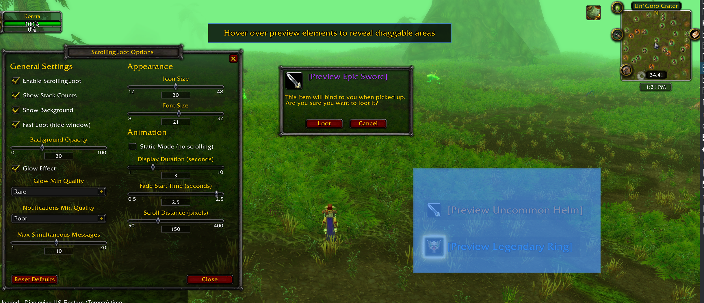

# ScrollingLoot

**ScrollingLoot** shows each item, money and honor pickup as a short notification with its icon, in a feed you can place anywhere on screen, so you do not have to read the chat log to see what you picked up.

Built for **TBC Classic Anniversary**, with experimental **WoW Forever** support.

On Anniversary it was last tested in game during the early phase (Karazhan and
Magtheridon's Lair). The v1.1.0 changes (the Fast Loot fixes and hover to pause)
have local tests but have not been tried on Anniversary in game; I have not had
time to test there since.

### WoW Forever (experimental)

The same download loads on WoW Forever, where it is listed as "Scrolling Loot
(Forever Experimental)". It has been tested solo in the open world only. Groups,
dungeons, raids, battlegrounds and boss fights are untested. In those places
Forever can hide loot chat text from addons; ScrollingLoot then reads pickups
from the loot window instead, but that has not been checked inside an instance
yet, so the feed may miss loot there. Differences from Anniversary:

- Defaults to a compact, static feed with smaller icons and text and a dark
  background. Every setting can still be changed.
- Pickups are also read from the loot window, so they still appear where the
  game hides loot chat text from addons. Each pickup is shown once.
- Fast Loot (off by default) uses Forever's own bind-on-pickup prompt instead of
  the custom dialog.
- The options window is the same as on Anniversary. The game's Options > AddOns >
  Scrolling Loot (Experimental) entry has a button that opens it.
- Forever's own loot toasts are unchanged. If they overlap with the feed, turn off
  the game's Show Item Toasts setting.

---

## Features

- **Floating notifications** - Items scroll upward (or fade in place with Static Mode), positionable anywhere on screen
- **Item icons** - Each notification includes the item's icon for quick recognition
- **Quality colors** - Text is colored by item rarity (grey → white → green → blue → purple → orange)
- **Stack counts** - Shows quantity for multi-item loots (e.g., "Wool Cloth x5")
- **Repeats add up** - Looting the same item again while its line is on screen adds to that line instead of opening a new one; gold and honor add up the same way
- **No lost lines** - When the feed is full, new pickups wait and appear as older lines expire, instead of pushing the oldest line out
- **Money notifications** - Gold, silver, and copper pickups display with appropriate coin icons
- **Honor notifications** - Honor point gains display with faction-appropriate PvP icons (Horde/Alliance) and customizable text color
- **Fast Loot mode** - Takes every item at once and hides the loot window (hold SHIFT to show it). The window still opens when your bags are full and there is an item to take, or when items are left for the master looter
- **BoP confirmation (Anniversary)** - With Fast Loot on, a Bind-on-Pickup dialog shows the item's icon and name
- **Drag-to-position** - Drag the preview areas to place the notifications and, on Anniversary, the BoP dialog
- **Live preview** - Sample notifications show while the options window is open, so changes are visible as you make them
- **Quality filter** - Hide low-quality items to reduce clutter
- **Optional background** - Add a subtle dark background behind text for better visibility
- **Glow effect** - Optional glowing highlight around item icons based on quality threshold
- **Hover to pause** - Hovering a notification pauses the feed and shows the item's tooltip; clicks pass through to the game world
- **Settings** - Icon size, font size, scroll speed, fade timing, and more

---

## Usage

Type `/sloot` to open the options panel. Blue highlighted areas appear over the preview elements; drag them to set where the loot notifications (and, on Anniversary, the BoP confirmation dialog) appear.

### Slash Commands

- `/sloot` - Open options panel
- `/sloot test` - Show test notifications
- `/sloot testmoney` - Show test money notifications
- `/sloot testhonor` - Show test honor notifications
- `/sloot help` - List the commands
- `/sloot on` - Enable addon
- `/sloot off` - Disable addon
- `/sloot reset` - Reset to defaults

---

## Configuration Options

**General**
- Enable/Disable addon
- Show stack counts
- Show background behind text
- Show money pickups (gold/silver/copper with coin icons)
- Show honor points (with faction PvP icons and customizable color)
- Fast Loot (hide window) - auto-loot and hide loot window; hold SHIFT to show normally
- Background opacity
- Glow effect toggle
- Glow minimum quality threshold
- Notifications minimum quality filter
- Max simultaneous messages

**Appearance**
- Icon size
- Font size
- Text alignment (Left, Center, Right)

**Animation**
- Static Mode (items fade in place without scrolling)
- Display duration (how long messages stay visible)
- Fade start time
- Scroll distance (disabled in Static Mode)
- Hover to pause + tooltip (on by default)

**Position**
- Drag the preview area to set the position

---

## License

MIT License - Open source and free to use.

---

## Feedback & Issues

Found a bug or have a suggestion? Post a comment / message me on CurseForge, or open an issue on GitHub: https://github.com/clearcmos/ScrollingLoot
